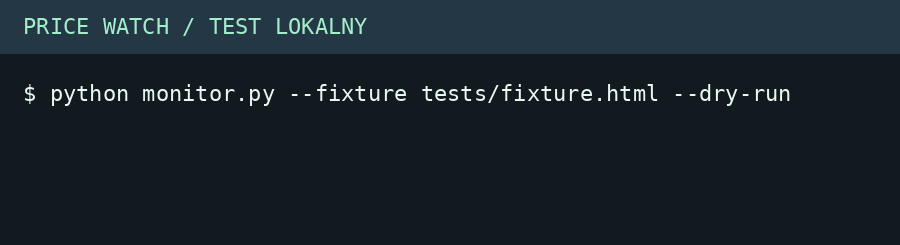

# Price Watch

Projekt koncepcyjny – marka fikcyjna

Monitor cen książek z historią w SQLite oraz powiadomieniami e-mail i Telegram.

## Overview

A Python portfolio project for price tracking, web extraction, and alerts. Playwright reads the Books to Scrape practice catalog, BeautifulSoup parses it, and SQLite records changes. New matches and price drops below the configured threshold enter an outbox.

The GIF shows output from the included local fixture. No external messages are sent in dry-run mode. Use separate databases for local examples and live monitoring.

## Files

- `monitor.py`, `.env.example`, and `requirements.txt`: implementation and configuration.
- `tests/`: deterministic HTML fixture and pytest checks.
- `Dockerfile` and `.github/workflows/test.yml`: container and CI.
- `exports/`: a GIF and output from the local fixture.
- `index.html`: Polish project demo and downloads.

## Run and edit

Install with `pip install -r requirements.txt` and `python -m playwright install chromium`. Copy `.env.example` to `.env`. Set the maximum GBP price, keyword, and page count. To test offline run `python monitor.py --fixture tests/fixture.html --dry-run`. Run `python monitor.py --dry-run` for a live read with local history. Configure SMTP or Telegram and run without dry-run to deliver queued alerts. Keep credentials in the local environment. Schedule a single instance via your system scheduler.

Run tests with `python -m pytest -q`. To build the container use `docker build -t price-watch .` and run it with a mounted directory for SQLite and an environment file.

## Technology

Python, Playwright, BeautifulSoup, SQLite, SMTP, Telegram Bot API, Docker, pytest and GitHub Actions.
